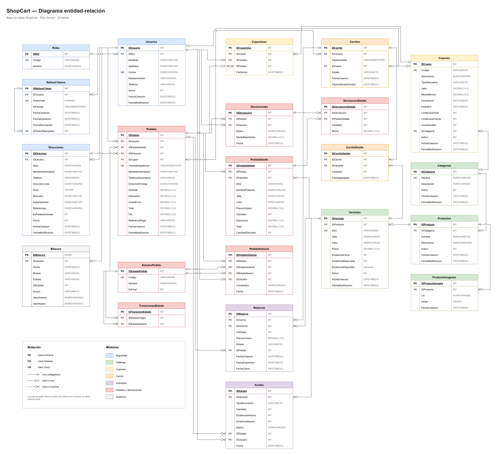
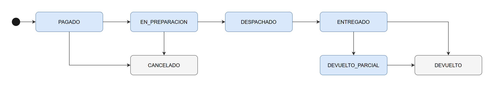

# ShopCart

Plataforma de ventas en línea: catálogo con variantes, inventario con kardex, carrito, cupones, checkout, pedidos con devoluciones, reportes y bitácora.

Tech Challenge 360 — Grupo Pentandra.

## Estado

| Fase | Contenido | Estado |
|---|---|---|
| 1 | Base de datos y backend | Completa |
| 2 | Frontend y proyecto completo | Pendiente |

## Stack

| Capa | Tecnología |
|---|---|
| Base de datos | SQL Server 2019+ (desarrollado en 2022) |
| Backend | Node.js 24, TypeScript (strict), Express 5 |
| Acceso a datos | `mssql`, únicamente stored procedures con parámetros tipados |
| Validación | Zod |
| Autenticación | JWT (access token) + refresh token con rotación, contraseñas con bcrypt |

## Estructura

```
techChallenge/
├── database/
│   ├── 001 … 008        tablas, constraints, índices y triggers
│   ├── 009 … 010        datos de catálogos y datos de prueba
│   ├── 011              login de la aplicación
│   └── storedProcedures/
├── backend/
│   └── src/
│       ├── config/       variables de entorno validadas
│       ├── db/           pool de conexión y ejecutarSP
│       ├── middlewares/  validación y manejo de errores
│       └── ...
└── docs/                diagrama ER y ciclo de vida del pedido (draw.io)
```

## Instalación

### Requisitos

- SQL Server 2019 o superior con **autenticación mixta** (SQL Server y Windows) y **TCP/IP habilitado** en el puerto 1433. El driver `mssql` no usa autenticación de Windows y solo se conecta por TCP.
- Node.js 24 o superior.

### Base de datos

Correr los scripts en orden por número: del `001` al `011` en `database/` y del `012` en adelante en `database/storedProcedures/`. Los de tablas y datos se corren una sola vez; los de stored procedures usan `CREATE OR ALTER` y se pueden volver a correr.

El `011` crea el usuario con el que se conecta el backend y pide su contraseña como variable (así no queda en el repositorio). Esa misma contraseña va después en `DB_PASSWORD` del `.env`.

- **SSMS:** abrir y ejecutar cada archivo. Para el `011`, activar *Query > SQLCMD Mode* y agregar al inicio `:setvar APP_PASSWORD "<contraseña>"`.
- **sqlcmd:** usar `-I -f 65001` en todos, y en el `011` agregar la variable:

```bash
sqlcmd -S localhost -E -C -b -I -f 65001 -i database/001_CrearBaseDatos.sql
sqlcmd -S localhost -E -C -b -I -f 65001 -v APP_PASSWORD="<contraseña>" -i database/011_Usuario_Aplicacion.sql
```

### Backend

```bash
cd backend
npm install
cp .env.example .env
npm run dev
```

En `.env`, `DB_PASSWORD` es la misma contraseña usada en el `011`, y `JWT_ACCESS_SECRET` debe tener al menos 32 caracteres. Si falta o sobra algo, la API no arranca y dice qué variable está mal.

Comprobación: `GET http://localhost:3000/api/salud`.

## Credenciales de prueba

Contraseña para todos: `ShopCart2026!`

| Rol | Correo |
|---|---|
| Administrador | admin@shopcart.com |
| Operador | operador@shopcart.com |
| Cliente | cliente1@shopcart.com |
| Cliente | cliente2@shopcart.com |

Cupones de prueba: `BIENVENIDA10`, `DESCUENTO50` (mínimo Q300), `DEPORTES15` (solo Deportes), `VERANO2025` (vencido) y `ULTIMOUSO` (un solo uso, para probar concurrencia). Las variantes `BOT-42-CAF` y `BAL-5` tienen una sola unidad y `JEA-34-AZO` está agotada.

## Modelo de datos

### Convenciones

- Objetos según el estándar: `SP_Modulo_Proceso`, `VW_Modulo_Proceso`, `FU_Modulo_Proceso`, llaves `IDTabla`.
- Constraints con nombre explícito: `PK_`, `FK_`, `UQ_`, `CK_`, `DF_`, `IX_` / `UX_` (índice único filtrado), `TR_` (trigger).
- Montos en `DECIMAL(12,2)`. Fechas en `DATETIME2(3)` y en UTC.
- Nada se borra físicamente si tiene historia: se desactiva con `Activo = 0`.

### Diagrama entidad-relación



Editable en draw.io: [`docs/diagrama-er.drawio`](docs/diagrama-er.drawio).

### Reglas que protege la base de datos

Las reglas críticas no dependen solo del backend; si alguien escribe directo en las tablas, la base las rechaza igual.

| Regla | Cómo |
|---|---|
| Nunca hay sobreventa | `CK_Variantes_Reservada`: reservado ≤ físico, y la existencia física nunca baja de 0 |
| Existencia = suma del kardex | Cada movimiento guarda saldo anterior y nuevo (`CK_Kardex_Saldo`) y el signo debe corresponder al tipo (`CK_Kardex_Signo`) |
| Ajuste manual exige motivo | `CK_Kardex_MotivoAjuste` |
| Límite total de usos del cupón | `CK_Cupones_UsosActuales`: usos ≤ límite |
| Un cupón por pedido | `UQ_CuponUsos_IDPedido` |
| Sin pedidos duplicados | `UQ_Pedidos_ClaveIdempotencia`, y `SP_Pedidos_CrearPedido` bloquea la clave (`UPDLOCK, HOLDLOCK`) antes de crear: un reintento simultáneo espera y recibe el mismo pedido |
| Atomicidad del pedido | Pedido, detalle, kardex, reservas, uso del cupón, carrito, historial y bitácora en una sola transacción con `XACT_ABORT ON` |
| Nadie usa direcciones de otro | Los SPs de direcciones y de pedido filtran por el usuario de la sesión: una dirección ajena responde 404, igual que una inexistente |
| Siempre queda un Administrador activo | Al desactivar o quitar el rol, el SP bloquea el conjunto de administradores activos: dos cambios simultáneos no pueden dejar cero |
| Gestión de usuarios con privilegios vigentes | `SP_Usuarios_ValidarAdministrador` verifica en la BD, no en el token, que quien ejecuta sea Administrador activo |
| Descuento nunca deja el total bajo cero | `CK_Pedidos_Descuento` y `CK_Pedidos_Total` |
| No devolver más de lo vendido | El backend lo valida; `SP_Pedidos_RegistrarDevolucion` lo vuelve a validar con el pedido bloqueado y `CK_PedidoDetalle_CantidadDevuelta` es la barrera final |
| Transiciones de estado válidas | En tres capas: el servicio del backend (mapa de transiciones), el SP con el pedido bloqueado (tabla `TransicionesEstado`) y el trigger `TR_Pedidos_ValidarTransicion`, que rechaza aunque alguien actualice la tabla directo |
| Bitácora inmutable | Trigger `TR_Bitacora_Inmutable` (rechaza UPDATE y DELETE) |
| Un carrito activo por cliente | `UX_Carritos_UsuarioActivo` |
| Una dirección predeterminada por cliente | `UX_Direcciones_Predeterminada` |
| Acceso solo por stored procedures | El login `shopcart_app` solo tiene `EXECUTE`; no puede leer ni escribir tablas directamente |
| SPs internos fuera del alcance del backend | `DENY EXECUTE` para `shopcart_app` sobre `SP_Bitacora_Registrar`, `SP_Inventario_RegistrarMovimiento`, `SP_Inventario_LiberarReservas`, `SP_Inventario_ReservarExistencia`, `SP_Carrito_ObtenerOCrear`, `SP_Carrito_Resumen`, `SP_Pedidos_AplicarTransicion` y `SP_Usuarios_ValidarAdministrador`. Solo los llaman otros SPs: el backend no puede inventar registros de bitácora, mover existencia sin kardex ni leer un carrito por su ID |
| Un solo camino para mover existencia | `SP_Inventario_RegistrarMovimiento` es el único que cambia `ExistenciaFisica` (variante + kardex + bitácora en una transacción) |
| Nadie ve el carrito de otro | Los SPs del carrito nunca reciben un `IDCarrito`: lo ubican por el usuario de la sesión o por el token del invitado (`FU_Carrito_Activo`) |
| El descuento nunca deja el total bajo cero | El monto fijo se limita a la base elegible y el porcentaje no pasa de 100 (`CK_Cupones_Porcentaje`) |

## Ciclo de vida del pedido



Editable en draw.io: [`docs/ciclo-vida-pedido.drawio`](docs/ciclo-vida-pedido.drawio).

- El pedido nace en `PAGADO`: se crea en la misma transacción que confirma el pago simulado.
- El Operador (o el Administrador) lo avanza: `EN_PREPARACION` → `DESPACHADO` → `ENTREGADO`.
- Se cancela solo antes de `DESPACHADO`: lo puede cancelar el cliente dueño o el Operador. Cancelar reintegra todo lo vendido al inventario (kardex `CANCELACION`).
- `DEVUELTO_PARCIAL` y `DEVUELTO` no se fijan a mano: resultan de registrar devoluciones, que el Operador registra al recibir el producto. Lo devuelto vuelve al inventario (kardex `DEVOLUCION`).
- `CANCELADO` y `DEVUELTO` (en gris) son finales: de ahí el pedido ya no cambia de estado.
- Cada cambio queda en `PedidoHistorial` con usuario, fecha, estado anterior y nuevo, y en la bitácora.

## Decisiones técnicas

| Tema | Decisión | Motivo |
|---|---|---|
| Fechas | UTC; los reportes convierten a hora de Guatemala | No depende de la zona del servidor |
| Categorías | Planas, sin subcategorías | Simplifica cupones por categoría |
| Roles | Un rol por usuario | El enunciado define tres roles excluyentes |
| Atributos de variante | Columnas `Talla` y `Color` | Cubren el caso del enunciado sin una tabla genérica clave-valor |
| Pago | Simulado; no hay tabla de pagos | Un pedido = un cobro; la idempotencia vive en `Pedidos.ClaveIdempotencia` |
| Precio congelado | Se copia a `Reservas` al iniciar el pago y luego a `PedidoDetalle` | Se respeta el precio que vio el cliente aunque cambie después |
| Carrito | No guarda precio | Siempre muestra el precio vigente hasta que se inicia el pago |
| Dirección del pedido | Se copia al pedido | Editar o desactivar una dirección no altera pedidos anteriores |
| Descuento por línea | El cupón se prorratea entre las líneas | Permite calcular el reembolso de devoluciones parciales |
| Cupón en pedidos cancelados | El uso no se devuelve | Más simple y evita abusos |
| Reservas vencidas | Las libera un proceso del backend cada minuto | No depende de SQL Server Agent, que no existe en todas las ediciones |
| Configuración | Variables de entorno, sin tabla de parámetros | Son valores que no cambian en tiempo de ejecución |
| Bitácora | La escriben los SPs dentro de su transacción: la fila completa antes y después, en JSON (funciones `FU_Catalogo_*Json`) | El SP conoce al usuario y el valor anterior; si la operación falla, no queda registro huérfano |
| Búsqueda de texto | `CHARINDEX` con collation insensible a acentos, sin armar patrones `LIKE` | No hay concatenación; `%` y `_` se buscan literal; "balon" encuentra "Balón" |
| Eliminar productos | Borrado físico solo si ninguna variante tiene ventas, kardex, carritos ni reservas; si no, 409 y se desactiva | Cumple RF-02 y no rompe la trazabilidad del kardex |
| Existencia de una variante | La inicial entra por kardex al crearla; después solo cambia desde inventario | La existencia siempre es igual a la suma del kardex |
| Imágenes | Arreglo de URLs http/https; al actualizar, el arreglo reemplaza todas | Sin carga de archivos en esta fase |
| Validar y mover existencia | Un solo `UPDATE ... WHERE ExistenciaFisica + @Cantidad >= ExistenciaReservada` | Dos movimientos simultáneos no pueden leer el mismo saldo; no hace falta bloquear antes |
| Movimientos en bitácora | Todo movimiento de existencia (manual o por venta, cancelación o devolución) queda en kardex y en bitácora, módulo INVENTARIO | RF-09 pide registrar cambios de existencias |
| Orden de bloqueo | Siempre `Reservas` antes que `Variantes` | Evita deadlocks entre el checkout y la liberación de reservas. Si aun así ocurre uno (error 1205), la API responde 409 "intente de nuevo" |
| Liberación de reservas | Un proceso del backend llama a `SP_Inventario_LiberarReservasVencidas` cada minuto | Es seguro con varias instancias: una segunda ejecución ya no encuentra las reservas activas |
| Conciliación | `VW_Inventario_Conciliacion` compara existencia con la suma del kardex y reservado con las reservas activas | Permite demostrar el criterio de aceptación de RF-03 en cualquier momento |
| Carrito de invitado | Token aleatorio (`NEWID`) que el cliente envía en el encabezado `X-Carrito-Token` | Un UUID v4 no se puede adivinar; el carrito nunca se pide por su ID |
| Fusión al iniciar sesión | `POST /carrito/fusionar`: se suman cantidades sin pasar de lo disponible, nunca se reduce lo que el cliente ya tenía, y si no tenía cupón se conserva el del invitado | El cliente no pierde lo que agregó antes de entrar |
| Existencia al agregar al carrito | Se valida contra lo disponible al agregar o aumentar; disminuir siempre se permite. No reserva | Dos carritos pueden tener la última unidad; solo uno la obtiene en el checkout (RF-06) |
| Cambios al carrito durante el checkout | Agregar, modificar, quitar o cambiar el cupón libera las reservas del checkout en curso | El pedido nunca se arma con líneas distintas a las que el cliente confirmó |
| Monto mínimo del cupón | Se compara contra el subtotal de todo el carrito | El enunciado habla de "monto mínimo de compra" |
| Cupón por categoría | Descuenta solo sobre las líneas de esa categoría; si el carrito no tiene ninguna, se rechaza | Un cupón de categoría no debe descontar otros productos |
| Reparto del descuento | En centavos enteros con el método del mayor residuo (`FU_Cupones_CalculoDescuento`) | La suma por línea es exactamente el descuento total, ninguna línea queda negativa y las devoluciones parciales reembolsan lo correcto |
| Cupón que deja de ser válido | Se queda en el carrito sin descontar y con el motivo (vencido, agotado, mínimo no alcanzado) | El cliente entiende por qué cambió el total |
| Límite de usos por cliente | Al aplicar el cupón se revisa si hay sesión; para invitados se revisa al crear el pedido | El invitado no tiene identidad hasta iniciar sesión |
| IVA | Los precios incluyen 12 %; el IVA contenido es `total × 12 / 112`, redondeado a centavos | Se informa en el carrito y se guarda en el pedido |
| Eliminar cupones | Solo si nunca se usó; si estaba aplicado en carritos, se les quita | Igual que productos: lo usado se desactiva |
| Checkout en dos pasos | `iniciar` reserva todo el carrito 15 min y congela precios; `pagar` crea el pedido | El cliente ve el total final antes de pagar, y la existencia queda apartada mientras paga |
| Reserva todo o nada | Si una variante no alcanza, no queda ninguna reserva y el mensaje dice cuál y cuántas quedan | El cliente no termina con un pedido incompleto |
| Precio y descuento respetados | El pedido se arma con el precio congelado en la reserva, con la misma función de totales que mostró el resumen | Si el precio cambia durante el pago, el cliente paga lo que vio |
| Cupón al pagar | Se vuelve a validar al pagar, con la fila del cupón bloqueada | El límite total y el límite por cliente se respetan aunque varios lo usen a la vez |
| Idempotencia | Encabezado `Idempotency-Key` (UUID que el cliente genera una vez por intento de pago). La primera vez: 201; un reintento: 200 con el mismo pedido y el encabezado `Idempotent-Replayed: true` | Mismo patrón que las pasarelas de pago reales |
| Pago | Simulado: se aprueba en la misma transacción y la referencia (`SIM-...`) se deriva de la clave de idempotencia | Un reintento no puede generar un segundo cobro. Con una pasarela real se le enviaría la misma clave |
| Envío | Tarifa fija (`COSTO_ENVIO`, Q35), gratis desde `ENVIO_GRATIS_DESDE` (Q500) después del descuento | Configurable sin tocar código |
| Reserva vencida | Pagar con la reserva vencida responde 409 y hay que volver a iniciar | No se puede cobrar algo cuya existencia ya se liberó |
| Direcciones | Máximo 10 activas por cliente; la primera queda como predeterminada; eliminar desactiva y, si era la predeterminada, pasa a serlo la más reciente | Los pedidos guardan su copia, así que se pueden desactivar sin afectar historia |
| Reembolso de devoluciones | Devolver k de n unidades de una línea reembolsa `ROUND(total × k / n)` menos lo ya reembolsado de esa línea | Varias devoluciones parciales suman exactamente el total de la línea (ya con su parte del descuento) |
| Envío en devoluciones | No se reembolsa | Se cobra por el servicio de entrega, que sí se prestó |
| Producto devuelto | Vuelve a la existencia disponible | Se asume que el Operador solo recibe producto en condiciones de venta; si no, puede hacer un ajuste con motivo |
| Quién registra devoluciones | Operador o Administrador | La devolución se registra cuando el producto llega a la tienda |
| "Pedido completado" en reportes | Por defecto, pagado y no cancelado (todo pedido nace pagado). Con `soloEntregados=true`, solo los entregados. La regla vive en una sola vista: `VW_Reportes_VentasNetas` | El enunciado deja abierta la definición; el glosario calcula el ticket promedio sobre "pedidos pagados" y el negocio quiere ver ventas sin esperar la entrega |
| Devoluciones en reportes | Se descuentan de la venta original, línea por línea y con el monto exacto reembolsado | Las cifras de un periodo reflejan lo que finalmente se vendió en él |
| Envío en reportes | No cuenta como venta | Es un cobro por servicio, no por producto |
| Categoría en reportes | La categoría actual del producto | El detalle del pedido no guarda la categoría |
| Periodos de reportes | Días de Guatemala; semanas de lunes a domingo; los periodos sin ventas salen en cero. Sin fechas: últimos 30 días. Máximo: dos años | Las gráficas no tienen huecos y las ventas nocturnas no se corren al día siguiente por UTC |
| Carritos abandonados | Activos, con productos y sin actividad por `CARRITO_ABANDONADO_MINUTOS` (60); se puede cambiar por consulta | El enunciado pide un periodo configurable |
| Desactivar un usuario | No borra nada y revoca todas sus sesiones; conserva acceso a lo sumo lo que le quede a su access token (15 min) | "Un usuario puede desactivarse sin borrarse" |
| Restablecer contraseña | Lo hace el Administrador; revoca todas las sesiones del usuario y en la bitácora no queda ningún hash | Si alguien conocía la contraseña anterior, pierde el acceso |
| Cambio de rol | Aplica en el siguiente refresh: el SP de rotación lee el rol de la base de datos | No hace falta cerrar sesión |
| Protección del propio Administrador | No puede desactivarse ni quitarse el rol a sí mismo | Evita que el sistema se quede sin administración por error |
| Documentación de la API | OpenAPI generado en código a partir de los esquemas Zod, servido con Swagger UI | Una sola fuente de verdad para validar y documentar |
| Hash de contraseñas | `bcryptjs`, costo 10 | JavaScript puro, sin compilación nativa |
| Refresh token | Valor aleatorio de 256 bits en cookie `httpOnly` + `SameSite=Strict`; en la BD solo su SHA-256 | El JavaScript del navegador no puede leerlo y una copia de la BD no sirve para abrir sesión |
| Rotación | Cada refresh revoca el token usado. Si llega uno ya revocado, se revoca toda la sesión | Detecta el robo de un refresh token |
| Login | Mismo mensaje y mismo tiempo de respuesta si el correo no existe o la contraseña está mal | No permite averiguar qué correos están registrados |
| Access token | JWT HS256 de 15 minutos; no se consulta la BD en cada petición | Un usuario desactivado conserva acceso como máximo 15 minutos; su refresh ya no funciona |

## API

Base: `http://localhost:3000/api`

**Documentación interactiva (Swagger UI):** `http://localhost:3000/api/docs`. El documento OpenAPI 3.1 está en `/api/docs/openapi.json`. Los parámetros y cuerpos se **generan de los mismos esquemas Zod que validan las peticiones** (`z.toJSONSchema`), así que la documentación no puede desfasarse de la validación; lo que se escribe a mano es el resumen, el rol requerido y el significado de cada respuesta. Para probar endpoints protegidos: iniciar sesión, copiar el `accessToken` y pegarlo en **Authorize**.

### Autenticación

| Método | Ruta | Acceso | Descripción |
|---|---|---|---|
| POST | `/auth/registro` | Público | Registra un cliente y abre sesión |
| POST | `/auth/login` | Público | Inicia sesión |
| POST | `/auth/refresh` | Cookie | Rota el refresh token y entrega un access token nuevo |
| POST | `/auth/logout` | Cookie | Cierra la sesión (revoca el refresh token) |
| GET | `/auth/perfil` | Token | Datos del usuario autenticado |

- `registro`, `login` y `refresh` responden `{ accessToken, usuario }` y dejan el refresh token en la cookie `refreshToken`.
- Las rutas protegidas usan `Authorization: Bearer <accessToken>`. Sin token, token inválido o expirado: **401**. Rol sin permiso: **403**.
- `registro` y `login` comparten un límite de 10 intentos por IP cada 15 minutos (**429**).

### Catálogo — tienda (público)

| Método | Ruta | Descripción |
|---|---|---|
| GET | `/catalogo/categorias` | Categorías activas |
| GET | `/catalogo/productos` | Búsqueda paginada |
| GET | `/catalogo/productos/:id` | Detalle con imágenes y variantes activas |

Filtros de `/catalogo/productos`: `texto`, `idCategoria`, `precioMin`, `precioMax`, `disponible=true`, `orden` (`recientes`, `nombre`, `precio_asc`, `precio_desc`), `pagina`, `tamanio` (máx. 100). La tienda no expone existencia física, reservas ni estados internos.

### Catálogo — administración

Requieren token. Consultar: Administrador u Operador. Modificar: solo Administrador.

| Método | Ruta | Descripción |
|---|---|---|
| GET | `/admin/catalogo/categorias` | Todas, incluidas las inactivas |
| POST | `/admin/catalogo/categorias` | Crear |
| PUT | `/admin/catalogo/categorias/:id` | Modificar |
| PATCH | `/admin/catalogo/categorias/:id/estado` | Activar / desactivar (`{ "activo": false }`) |
| DELETE | `/admin/catalogo/categorias/:id` | Eliminar (solo sin productos ni cupones) |
| GET | `/admin/catalogo/productos` | Búsqueda paginada; mismos filtros + `activo` |
| GET | `/admin/catalogo/productos/:id` | Detalle completo con existencias |
| POST | `/admin/catalogo/productos` | Crear (con `imagenes`) |
| PUT | `/admin/catalogo/productos/:id` | Modificar |
| PATCH | `/admin/catalogo/productos/:id/estado` | Activar / desactivar |
| DELETE | `/admin/catalogo/productos/:id` | Eliminar (solo sin historia) |
| POST | `/admin/catalogo/productos/:id/variantes` | Crear variante (con `existenciaInicial`) |
| PUT | `/admin/catalogo/variantes/:id` | Modificar SKU, talla, color o precio |
| PATCH | `/admin/catalogo/variantes/:id/estado` | Activar / desactivar |

Los listados responden `{ datos, paginacion: { pagina, tamanio, total, totalPaginas } }`.

### Inventario

Requieren token de Administrador u Operador.

| Método | Ruta | Descripción |
|---|---|---|
| GET | `/admin/inventario/existencias` | Existencias por variante. Filtros: `texto` (SKU o producto), `idCategoria`, `existenciaMaxima` (0 = agotadas), `activo`, `orden` (`sku`, `disponible`) |
| GET | `/admin/inventario/variantes/:id/kardex` | Movimientos de una variante. Filtros: `tipo`, `fechaDesde`, `fechaHasta` (AAAA-MM-DD, hora de Guatemala) |
| POST | `/admin/inventario/variantes/:id/entradas` | Entrada por compra: `{ "cantidad": 10, "motivo": "Factura 123" }` |
| POST | `/admin/inventario/variantes/:id/ajustes` | Ajuste manual con signo: `{ "cantidad": -2, "motivo": "Producto dañado" }` |
| GET | `/admin/inventario/conciliacion` | Variantes cuya existencia no cuadra con el kardex o con las reservas (debe venir vacío) |

Un ajuste que deje la existencia en negativo o por debajo de lo reservado responde **409**.

### Carrito

Lo usan invitados y clientes; administradores y operadores reciben 403. Con sesión (`Authorization`) el carrito es el del cliente. Sin sesión se usa el encabezado `X-Carrito-Token`: la primera vez que un invitado agrega algo, la respuesta trae `token` y el cliente debe guardarlo y enviarlo desde entonces.

| Método | Ruta | Descripción |
|---|---|---|
| GET | `/carrito` | Carrito actual (vacío si no hay) |
| POST | `/carrito/items` | Agregar: `{ "idVariante": 5, "cantidad": 2 }` (suma a lo que ya había) |
| PUT | `/carrito/items/:idVariante` | Fijar cantidad: `{ "cantidad": 3 }` |
| DELETE | `/carrito/items/:idVariante` | Quitar una línea |
| DELETE | `/carrito` | Vaciar |
| POST | `/carrito/cupon` | Aplicar cupón: `{ "codigo": "BIENVENIDA10" }` |
| DELETE | `/carrito/cupon` | Quitar cupón |
| POST | `/carrito/fusionar` | Con sesión y `X-Carrito-Token`: pasa el carrito de invitado al del cliente |

Todas responden el carrito completo: `token`, `items` (con `disponible` y `aviso` por línea), `cupon` (con `valido` y `mensaje`) y `resumen` (`subtotal`, `descuento`, `total`, `ivaIncluido`). Agregar más de lo disponible responde **409** con la cantidad que sí hay. Un cupón que no cumple una regla responde **422** con el motivo: no vigente, vencido, agotado, límite por cliente, categoría o mínimo de compra. Aplicar cupones tiene un límite de 20 intentos por IP cada 15 minutos.

### Cupones — administración

Solo Administrador.

| Método | Ruta | Descripción |
|---|---|---|
| GET | `/admin/cupones` | Listado paginado. Filtros: `texto`, `estado` (`VIGENTE`, `PROGRAMADO`, `VENCIDO`, `AGOTADO`, `INACTIVO`) |
| GET | `/admin/cupones/:id` | Detalle con usos |
| POST | `/admin/cupones` | Crear |
| PUT | `/admin/cupones/:id` | Modificar (el límite total no puede quedar por debajo de los usos ya registrados) |
| PATCH | `/admin/cupones/:id/estado` | Activar / desactivar |
| DELETE | `/admin/cupones/:id` | Eliminar (solo si nunca se usó) |

```json
{
  "codigo": "NAVIDAD25",
  "descripcion": "25 % en diciembre",
  "tipoDescuento": "PORCENTAJE",
  "valor": 25,
  "montoMinimo": 200,
  "fechaInicio": "2026-12-01T00:00:00-06:00",
  "fechaFin": "2026-12-31T23:59:59-06:00",
  "limiteUsosTotal": 500,
  "limiteUsosCliente": 1,
  "idCategoria": null
}
```

Las fechas van en ISO 8601 con zona horaria y se guardan en UTC.

### Direcciones

Solo Cliente, y siempre sobre sus propias direcciones.

| Método | Ruta | Descripción |
|---|---|---|
| GET | `/direcciones` | Direcciones activas (la predeterminada primero) |
| POST | `/direcciones` | Crear (`esPredeterminada` opcional) |
| PUT | `/direcciones/:id` | Modificar |
| PATCH | `/direcciones/:id/predeterminada` | Marcar como predeterminada |
| DELETE | `/direcciones/:id` | Eliminar (se desactiva) |

### Checkout

Solo Cliente. Flujo:

1. `POST /checkout/iniciar` reserva la existencia de todo el carrito por 15 minutos y congela precios. Responde el resumen con `expiraEn` y `segundosRestantes`. Si algo no alcanza: **409** con el producto y cuántas unidades quedan. Llamarlo de nuevo reinicia la reserva.
2. `GET /checkout` devuelve el mismo resumen mientras la reserva siga vigente (**404** si no hay pago en curso).
3. `POST /checkout/pagar` con `{ "idDireccion": 1 }` y el encabezado `Idempotency-Key: <uuid>` crea el pedido y responde **201** con el pedido completo. Repetir la petición con la misma clave responde **200** con el mismo pedido.

Modificar el carrito o su cupón durante el pago libera la reserva; hay que volver a iniciar.

### Pedidos — cliente

Solo sus propios pedidos: uno ajeno responde **404**, igual que uno inexistente.

| Método | Ruta | Descripción |
|---|---|---|
| GET | `/pedidos` | Historial paginado. Filtros: `estado`, `fechaDesde`, `fechaHasta` |
| GET | `/pedidos/:id` | Detalle con líneas, historial de estados y devoluciones |
| POST | `/pedidos/:id/cancelar` | Cancelar antes del despacho: `{ "motivo": "..." }` (opcional) |

### Pedidos — administración

Operador y Administrador.

| Método | Ruta | Descripción |
|---|---|---|
| GET | `/admin/pedidos` | Listado paginado. Filtros: `estado`, `idCliente`, `cliente` (nombre o correo), `fechaDesde`, `fechaHasta` |
| GET | `/admin/pedidos/:id` | Detalle de cualquier pedido |
| PATCH | `/admin/pedidos/:id/estado` | `{ "estado": "DESPACHADO", "comentario": "Guía 123" }`. Estados permitidos: `EN_PREPARACION`, `DESPACHADO`, `ENTREGADO`, `CANCELADO` |
| POST | `/admin/pedidos/:id/devoluciones` | `{ "motivo": "Talla incorrecta", "lineas": [{ "idPedidoDetalle": 7, "cantidad": 1 }] }` |

Una transición no permitida responde **409** (por ejemplo, cancelar un pedido despachado). Devolver más de lo pendiente en una línea responde **409** con la cantidad que sí se puede devolver.

### Reportes

Solo Administrador. Todos aceptan `fechaDesde` y `fechaHasta` (AAAA-MM-DD; por defecto los últimos 30 días) y `soloEntregados=true`. Cuentan pedidos no cancelados y descuentan devoluciones.

| Método | Ruta | Descripción |
|---|---|---|
| GET | `/admin/reportes/resumen` | Ventas netas, pedidos, unidades, ticket promedio, monto devuelto, pedidos cancelados y carritos abandonados |
| GET | `/admin/reportes/ventas` | Ventas y número de pedidos por `agrupacion` = `dia`, `semana` o `mes` |
| GET | `/admin/reportes/ventas-por-categoria` | Ventas, unidades y porcentaje por categoría |
| GET | `/admin/reportes/productos-mas-vendidos` | Top por unidades (`top`, por defecto 10) |
| GET | `/admin/reportes/carritos-abandonados` | Listado paginado; `minutosInactividad` opcional |

El listado de pedidos con filtros por estado, cliente y rango de fechas es `GET /admin/pedidos`.

### Bitácora

Solo Administrador. Registra creación, modificación, activación, desactivación y eliminación en catálogo, precios, existencias, cupones, estados de pedido, devoluciones y usuarios. `GET /admin/bitacora`, paginado, con filtros `modulo` (`CATALOGO`, `INVENTARIO`, `CUPONES`, `PEDIDOS`, `SEGURIDAD`), `entidad`, `idEntidad`, `accion`, `idUsuario`, `fechaDesde` y `fechaHasta`. Cada registro trae usuario, fecha, entidad, acción y los valores anterior y nuevo como objetos JSON. No hay endpoints para modificarla: la base de datos lo impide (`TR_Bitacora_Inmutable`).

### Usuarios

Solo Administrador. Los usuarios no se borran: se desactivan.

| Método | Ruta | Descripción |
|---|---|---|
| GET | `/admin/usuarios` | Listado paginado. Filtros: `texto` (nombre o correo), `rol`, `activo`. Incluye última sesión y cantidad de pedidos |
| GET | `/admin/usuarios/:id` | Detalle |
| POST | `/admin/usuarios` | Crear (`rol`: `CLIENTE`, `OPERADOR` o `ADMIN`; misma política de contraseña que el registro) |
| PUT | `/admin/usuarios/:id` | Modificar datos y rol |
| PATCH | `/admin/usuarios/:id/estado` | Activar / desactivar (desactivar cierra sus sesiones) |
| PATCH | `/admin/usuarios/:id/password` | Restablecer contraseña: `{ "password": "..." }` (cierra sus sesiones) |

Desactivarse o quitarse el rol a sí mismo, o dejar el sistema sin Administradores activos, responde **409**.

## Manejo de errores

Las respuestas de error siempre tienen la forma:

```json
{ "error": { "mensaje": "...", "detalles": [ ... ] } }
```

Los stored procedures lanzan errores de negocio con `THROW 50xxx`, donde `xxx` es el código HTTP (`50404` no encontrado, `50409` conflicto, etc.). El backend solo resta 50000; no hay una tabla de equivalencias que mantener. Las violaciones de UNIQUE y FK que se escapen se responden como 409, y cualquier otro error como 500 sin exponer detalles internos.
